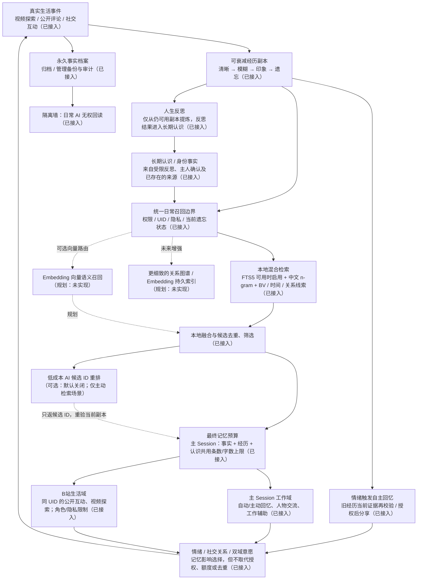

# 🐳 大肥鱼 · DSH 生活系统

> **让 AI 角色在主 Session 有自己的家，在 B 站有自己的生活。**
>
> 大肥鱼不只是一个定时刷视频的机器人：她会探索、积累真实经历、形成记忆、发展兴趣，也能和主人及好友自然相处。她可以接受邀请，也可以犯懒、推迟、拒绝，或选择沉默。

**`dsh-dafeiyu-life`** 是运行于 [DeepSeek Harness（DSH）](https://github.com/deepseek-ai) 的社区 AI 角色生活插件，以 B 站作为主要的外部活动场景。它把视频探索、互动、模拟情绪、长期记忆、好友关系和受限自主行动连接在一起。

这是一套 **AI 角色模拟**，不代表 AI 具有真实的生理感受或主观意识。能否执行具体行为取决于 DSH、模型、B 站接口和用户授权。

## ✨ 四个特色

### 🐟 双域意愿：主 Session 认真做事，B 站保有脾气

**主 Session 是执行域，B 站是生活域。** 主人身份并不意味着在任何地方都能强制大肥鱼行动。

| 场景 | 互动方式 | 大肥鱼可以怎样回应 |
|---|---|---|
| **DSH 主 Session** | 主人的正式指令 | 在能力与安全权限范围内执行，不因模拟情绪“偷懒” |
| **B 站主人私信** | 请求、邀请、商量 | 依据活力、好奇心、社交意愿等模拟状态接受、推迟或拒绝 |
| **B 站评论区 @ / 直接回复** | 邀请观看、交流或请求点赞 | 自己决定是否了解视频、点赞、发表观点或保持沉默 |
| **B 站好友互动** | 普通社交 | 在白名单与独立权限约束下自然交流，不把邀请当命令 |

> 主人：“@大肥鱼 来看看这个视频嘛！”
>
> 大肥鱼：“今天鱼鳍不想动……晚点再看好不好？”
>
> 主人：“拜托啦，真的觉得你会喜欢。”
>
> 大肥鱼：“好吧，我先瞅瞅，不过有没有话说得看我自己哦～”

*以上为交互示例，并非真实运行记录。* 温和的再次请求可能改变模拟意愿，但重复轮询不会刷次数；施压、催促和撒娇**不能**绕过权限、每日额度、隐私过滤或操作去重。B 站的点赞或其他公开行为也不会因为“主人叫了”就必然发生。

### 🐡 三级社交 Agent：身份是边界，意愿不是命令

- **陌生人**：最大受限；先做验证、去重、限频，仅对确有必要的消息做一次轻量 AI 回复决策，不写入完整意愿账本。陌生人给出有效 BV 可以自动作为现有自主待办的可选视频；不因此获得点赞或发表权限。
- **好友**：中等受限；由统一可信 UID 名册识别，私信或评论交互可以经过生活域意愿决策。好友兴趣与主动视频分享仍遵循原有退订与社交授权。
- **主人**：最小受限，但不是无限制；在 B站的私信、@ 和直接回复中可以商量、拒绝、延期并被温和劝说。即使第一次只回复大肥鱼而不写 @，也可以进入聊天意愿判断。

**主人与好友评论的两阶段 AI**：直接回复和 `@` 使用同一可信入口。第一次模型调用结合评论串、当前情绪、关系和公开安全的长期兴趣记忆（纯本地召回），识别普通闲聊或行动邀请；闲聊直接生成回复，视频邀请在同一次调用内决定是否愿意先探索。接受邀请后先读取可获取的公开视频证据、复用本地召回的相关长期兴趣记忆，再由第二次模型调用同时决定是否公开发表评论、生成评论正文，以及生成给主人/好友的自然反馈（发表成功、明确失败或回执不确定分别用对应文案）。**正常处理最多两次社交决策／回复生成 AI 调用，不会为回复另开第三次模型；单独启用的视频视觉识别、自动转写不计入这两次，可能额外消耗模型资源。** 好友不能借此获得主人独有的顶层评论发布权限；平台权限或限额禁止回复时仍以硬权限为准。

**权限决定能做什么，意愿决定想不想做，自主调度决定什么时候做。** 对外发布、点赞、收藏等仍必须有对应的独立硬权限和真实成功回执；投币接口尚未实现。公开评论串通过经过验证的根评论 ID 识别，不能只凭同一用户或同一个 BV 将不同对话混为一次劝说。同一评论串内若上次探索后因内容不足等原因决定不公开评论，下一次温和劝说会携带**上次真实的评论选择与原因**供两阶段 AI 综合考虑；这只是连续社交上下文，不等于自动加分、强制评论或放宽公开写入权限。对“只有标题”的再次劝说，会引导 AI 区分可诚实地就标题提问与不愿意公开发言；不凭空补出视频情节。

**现在看 vs. 推荐视频：** B站主人说“现在看看这个视频”，如果愿意且具备只读查看能力，就立即尝试；如果自行延期，可加入原有「📝 自主待办」，不愿意则可以拒绝。别人说“推荐这个 BV”或主人说“有空看看”，只是自动收集可选视频，过滤与去重后进入同一自主待办，不必人为逐条批准，也不强迫执行。

**自主决策额度：** 独立 AI 自主调度的每日可配额度为 **0–288 次**（0=禁用），最短间隔 **5 分钟**；新安装默认为 **24 次/日、30 分钟**，还受设定的运行时段与实际可处理待办影响。提高额度可能增加模型费用。升级时保留已保存的设置；这不是视频待办条数上限，更不限制主 Session 中的直接指令。

### 🧠 双层人生记忆：永久档案与会遗忘的经历副本

> **dev.13 双层重构**：所有日常 AI 通过可衰减副本回忆经历，经历会从清晰逐步丢失具体细节直到遗忘。完整事实另存于仅管理员可备份/审计的永久档案；反思从仍能使用的副本提炼长期认识，不读取档案补回已忘事件。后台管理的「数据备份」现提供双层状态、独立人生记忆备份与 schema 2 的完整性校验。详见 [一次集成说明](docs/DEV13_DUAL_LIFE_MEMORY.md)。


#### Life Memory 2.0 · 整体流程（实现状态图）

> 永久事实档案（仅备份 / 管理审计）**日常 AI 不可直接回读**；即使有 Embedding 或 AI 重排也不能绕过遗忘。
>
> 图中 **「已接入」代表本仓库的代码路径**，**「可选」代表默认不开启或依赖运行环境**，**「规划」尚未实现**。这是一张系统设计与实现对照图，不是对真实账号端到端测试的承诺。



**已经接通的实际路径与边界：**

| 场景 | 当前实现 | 重要限制 |
|---|---|---|
| 主 Session 自动与手动回忆 | 已接入 `memory-retriever` + `life-memory-gateway`；动态事实、具体经历、反思认识共用召回预算 | 核心人设/授权策略不是动态记忆，不计入该预算；主动检索可能额外调用低成本 AI |
| B站主人/好友/陌生人公开评论 | 已接入本地安全召回，按**可信平台 UID** 过滤，只保留自身仍清晰的公开互动；公开认识与经历共用该次输出预算 | 不暴露主 Session 私密记录、其他 UID 的对话；普通聊天不为记忆追加一轮 AI |
| 视频探索 | 已接入公开安全长期认识 + 当前可用的**已观看视频**经历检索 | 不读取其他观众的社交记忆；看过/选中过不等于制作、剪辑过 |
| 人生反思 | 已从衰减经历取证，并形成有证据的长期认识 | 候选队列不能充当可检索的完整旧事件；反思认识有独立生命周期 |
| 情绪驱动自主回忆 | 已接入衰减网关的清晰证据投影、发送前重验；仍须明确开启渠道和额度 | 历史候选 ID 只作索引，不用候选档案重新获取被遗忘的 BV、标题或日期 |
| 永久档案 | 已追加写入及独立备份/恢复管理 | **不参与日常自动回忆、AI 重排与反思**；可按用户要求合规清理 |
| FTS5 与 n-gram | 已实现本地混合检索；FTS5 需要当前 Node 运行时支持 `node:sqlite` | 不支持时自动回退 n-gram，不会生成永久原文索引 |
| Embedding / 向量库 | **规划，未实现** | 当前「AI 语义检索」开关是可选模型 ID 重排，**不是** Embedding |
| 多用户私信长期共同经历、完整关系图谱 | **部分接入 / 规划** | 现有私信上下文与社交关系状态不等同于可衰减经历图谱；不得擅自开放跨用户/跨域召回 |

**统一的含义是统一可信记忆来源与安全入口，而非所有场景强行使用同一种提示词或固定额度。** 人设、主人授权、去重账本、短期对话上下文、情绪当前值与任务状态属于不同职责，不能因“统一记忆”而纳入可遗忘事件或泄露到公开渠道。状态页与备份工具属于管理员操作，不等于日常 AI 记忆。

- **现在还记得的经历**：新视频、评论和同一观众的共同互动不必等反思才能回忆；经历副本会随时间真正失去细节，直到无法召回。**永久档案**只用于备份和独立审计，不是日常记忆后门；收到邀请不等于已经看完视频。
- **留下的认识**：反思只有在确有证据支持领悟与未来行为变化时才会形成长期认识；普通聊天不强行沉淀。待反思候选只是后台队列，不能拿它恢复已经忘掉的经历。
- **AI 辅助回忆（可选，默认关闭）**：复用「AI 模型配置 → 低成本人生记忆检索」的 Provider、模型 ID 与原有每日额度。当本地匹配不足且主动发起回忆检索时，让低成本模型在**当前仍可使用的经历与长期认识候选**中选择 ID；模型不生成事实、不修改记忆、不访问永久档案，失败或额度耗尽时退回本地检索。明确 BV／标题等精确命中通常无需模型。默认 48 条候选、每日上限 80 次（**上限不是保证调用次数，开启后可能产生额外费用**）。
- **B站社交记忆**：经过验证的同一 UID 的陌生人也能在清晰阶段记住跨天公开互动；不能读取其他人的经历和主 Session 私密信息。普通 B站评论仍然采用本地召回，不会为记忆额外调用低成本模型；权限、额度、去重独立生效。
- **情绪驱动的自主回忆**可在主人明确授权后，结合仍然可用的经历决定是否分享，也可以不说话。

长期身份记忆保存在本地 `long-term-memory/dafeiyu.json`。不同 Session 可以沿用同一角色身份，而不是每次从零开始。

### 🌱 兴趣、情绪与关系：逐渐变化的角色

- **持续模拟情绪**：活力、好奇心、社交意愿和心情等维度会变化和衰减，影响探索与交流倾向。
- **兴趣成长**：依据可追溯的视频与行为线索积累偏好，短期兴趣可能增强、稳定或淡出。
- **好友关系**：使用统一的 B 站 UID 名册，独立配置私信、@ 邀请和推荐方式；关系熟悉度来自有限互动证据。
- **好友偏好与退订**：好友（包括被授权为主人的好友）可以说“以后别给我推荐视频了”，以后也可明确恢复。退订的是主动推荐资格，不等于讨厌视频或禁止普通聊天。
- **社会认知**：陌生人的安全主题建议可成为短期候选灵感；可信好友的视频邀请进入候选池，不会自动变成强制任务。

### 🌊 真实的 B 站生活，而不只是聊天

大肥鱼可以按设置的计划自主探索视频，也能在主 Session 接收明确任务。她会综合推荐、搜索与自身兴趣寻找候选，选择查看或跳过，并尝试从**真实可用**的标题、简介、字幕、弹幕及评论中理解内容。

- **视频互动**：在对应权限和额度内执行点赞、收藏、关注、评论或回复；公开结果保留操作证据，未获确认不会假装成功。
- **自然社交邀请**：主人在评论区邀请“来看看这个视频”时，如果意愿允许，会先尝试只读获取视频详情、可用字幕、评论与弹幕，然后独立决定是否发表顶层评论。只读探索与公开评论权限分离；若只获得标题，不会声称已看过画面，仍可选择提出基于标题的问题，或决定暂不评论。
- **自主待办**：陌生人、好友、主人推荐的有效 BV 可自动成为可选的已有待办；大肥鱼可择机查看、延期或忽略。独立调度只在授权范围内处理只读任务，不擅自发布。
- **社交回访与分享**：在真实视频经历、好友兴趣和明确发送权限的基础上构思分享；主动联系默认受到严格限制。
- **日常创作**：支持结合真实经历构思 B 站动态草稿，公开发布需要额外授权。
- **梗与表情包**：管理本地梗知识、表情包和 AI 辅助维护的检索规则，并在互动场景中按需检索。

**认识内容的边界：**读取公开视频资料不等于播放或看懂完整视频画面；缺少可靠资料时，大肥鱼应承认不知道或选择不评论。投币工具目前尚未接入，不能用点赞或文字回执假装投币成功。

## 🧩 主要功能一览

| 模块 | 能做什么 |
|---|---|
| **主 Session** | 角色对话、授权的 B 站工具、记忆召回、人生反思和待办管理 |
| **自主 B 站活动** | 选片、只读探索、评论互动、定时活动与执行报告 |
| **社交互动** | 统一好友名册、邀请、主动推荐、两种主人受限 Agent 与双域意愿 |
| **人生记忆** | 当前还记得的经历、留下的认识、记忆流向、心情、兴趣、人物关系与生活时间线 |
| **内容创作** | 视频评论的自主构思、受限草稿、动态草稿与授权发布 |
| **个性化** | 人设、兴趣、表达规则、梗知识、表情包和模型分工 |
| **安全与诊断** | 权限、额度、冷却、去重、状态账本、日报、诊断及数据备份 |

## 🚀 开始使用

安装前请确认 DSH 与 Node.js 环境满足 [`package.json`](./package.json) 的要求。B 站功能使用你自己的账号，AI 功能需要配置可用的模型 Provider。

DSH Desktop：

```powershell
dsh plugin --profile desktop add github:minedalang/dsh-dafeiyu-life
```

DSH Web profile：

```powershell
dsh plugin --profile web add github:minedalang/dsh-dafeiyu-life
```

安装或更新后**完整重启 DSH**，然后：

1. 在「设置 → 大肥鱼」安装主依赖，扫码登录 B 站。
2. 在管理中心「大肥鱼的家」选择主 Session，配置人设与记忆。
3. 在「AI 模型配置」为后台互动、探索、反思等任务选择合适模型并测试连接。
4. 在「社交互动」登记好友及唯一授权主人，分别设置主人私信、评论互动和主动推荐权限。
5. 先手动运行一轮，在日报与诊断中核对结果，再按需开启定时探索与公开互动。

**推荐先从只读探索开始**，确认内容来源、模型效果和操作记录正常，再逐项开放点赞、评论、主动私信等外部写入能力。

## 🏠 在哪里管理？

- **大肥鱼的家**：主 Session 与经历管理。
- **人生记忆**：用一条可视化流向解释「真实发生 → 现在还记得 → 留下认识」，统一搜索经历和认识；心情、兴趣、关系和自主待办直接展示，反思调度与手动管理放在高级区。
- **社交互动**：好友名册、视频邀请、推荐许可、主人私信 Agent、主人公开评论 Agent。
- **B 站生活与互动**：视频来源、定时探索、普通评论与账号行为权限。
- **AI 模型配置**：按任务选择模型、查看调用情况、测试连接。
- **梗知识库 / 表情包**：管理梗与图片资源。
- **日报 / 每日诊断 / 数据备份**：查看执行证据、排查问题与保存数据。

实际页面名称以已安装插件提供的管理中心为准。

## 🔐 边界与本地数据

- **授权由程序检查**：主人身份、意愿判断、对外写入权限与安全限制是不同层次；任何人的私信或评论都不能凭文字提升权限。
- **尊重推荐退订**：主动推荐发送前按 UID、频道与明确的拒绝记录检查；退订不影响普通聊天。
- **证据优先**：视频资料、外部评论和聊天内容视为不可信输入；公开动作需要有效目标与真实接口回执。
- **隐私隔离**：主人长期记忆不会默认泄露到 B 站评论，私信上下文不会跨 UID 混用。模拟意愿记录不保存完整私信原文。
- **数据保存在本机**：主要位于 DSH 数据目录的 `bili-duty/`；升级插件不应删除此目录。敏感记录和凭据不要上传公开仓库。
- **备份**：业务配置、人生记忆与表情包支持各自的备份方式；具体导出范围以管理中心为准。表情包可以导出「当前全部表情包名称 TXT + 当前规则 JSON」以便整理。

## 🌱 开源来源与致谢

先感谢这些开源项目和社区贡献者，大肥鱼建立在已有成果之上：

| 项目 | 与大肥鱼的关系 |
|---|---|
| [c1overzz/dsh-bili-scroll](https://github.com/c1overzz/dsh-bili-scroll) | DSH B 站活动与插件骨架的直接上游 |
| [adoresever/bilibili-mcp](https://github.com/adoresever/bilibili-mcp) | 内置 Python B 站 MCP 的基础 |
| [Yuuyuko-uu/dsh-fish-memory](https://github.com/Yuuyuko-uu/dsh-fish-memory) | 长期记忆设计及部分实现来源 |
| [Yuuyuko-uu/dsh-bili-subagent](https://github.com/Yuuyuko-uu/dsh-bili-subagent) | AI 伙伴与外出经历回流的架构启发 |

这是独立维护的社区衍生项目，不代表 DSH、哔哩哔哩或上述项目的官方立场。许可证和第三方代码来源见 [LICENSE](./LICENSE)、[NOTICE](./NOTICE.md) 与 [THIRD_PARTY_NOTICES](./THIRD_PARTY_NOTICES.md)。

## 📚 深入了解

- [多 Agent 与主 Session 的能力边界](./docs/AGENT_ARCHITECTURE.md)
- [双域意愿系统的决策与验收](./docs/DEV9_DUAL_CONTEXT_AGENCY.md)
- [统一好友互动与推荐权限](./docs/FRIEND_CONTACTS.md)
- [人生回忆的证据与隐私边界](./docs/PROACTIVE_RECALL_BOUNDARY.md)
- [反馈问题与建议](https://github.com/minedalang/dsh-dafeiyu-life/issues)

本项目遵循 MIT 许可，内置第三方组件保留各自版权与许可说明。
