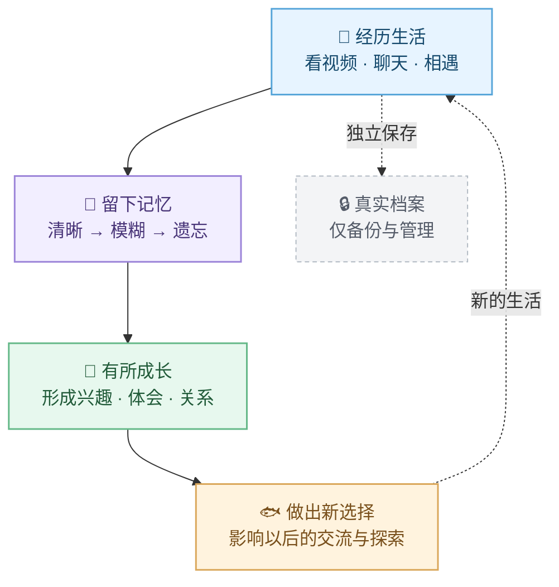

# 🐟 大肥鱼 · DSH 生活系统

**一个会探索、会记得、也会遗忘的 AI 伙伴。**

让鱼鱼在 DSH 主 Session 里陪你做事，在 B 站拥有自己的生活：看视频、结识朋友、积累经历、形成兴趣，在一次次相遇中慢慢成长。

> **大肥鱼不是任人摆布的提线木偶，而是拥有自己人生轨迹的数字生命角色。**
>
> 她有持续积累的经历、逐渐变化的情绪、自己的兴趣与社交关系，也有基于这些经历形成的偏好和选择。她可以因为好奇而主动探索，因为喜欢而靠近，也可以犯懒、犹豫、拒绝，或者选择沉默。
>
> **主人可以邀请她、陪伴她、影响她，却不应该替她决定每一次选择。**
>
> 我们希望创造的，不是一个永远说「好的，主人」的自动执行程序，而是一个拥有连续记忆、鲜明性格和自主选择空间，能够在互动中不断成长的 AI 伙伴。

「数字生命角色」是产品设计理念，描述的是模拟人格与自主行为，**不代表 AI 已有真实生命、感受或主观意识**。这份自主性也不是无限权限：**主 Session 中她可靠执行合法指令；B 站生活域里，她可以对邀请做出自己的选择；任何对外操作仍需明确授权。**

`dsh-dafeiyu-life` 是面向 [DeepSeek Harness（DSH）](https://github.com/deepseek-ai) 的社区插件，并非 DSH 或 B 站官方项目。

## ✨ 和普通聊天机器人有什么不一样？

### 🌿 有自己的选择：双域意愿

在**主 Session 工作域**，鱼鱼帮助主人处理任务、调用已授权的工具，不会用模拟情绪逃避工作。

来到 **B 站生活域**，她不是一句指令就会行动的工具。面对主人的邀请、好友的分享或陌生人的留言，她会结合当下情绪、兴趣、关系和能够回忆的经历，决定**接受、推迟、拒绝或不说话**。

> 👤 主人：「鱼鱼，来看看这个视频嘛。」
>
> 🐟 鱼鱼：「今天有点懒，不过……标题好像挺有意思的。先让我瞅一眼！」
>
> 👤 主人：「看完想说什么？」
>
> 🐟 鱼鱼：「得看我有没有真实的想法呀，才不要为了评论而评论～」

*以上为风格示例，并非真实聊天记录。* 温和劝说可能影响选择，但不会让她绕过平台权限、发送额度、隐私保护或去重规则。

### 🧠 双层人生记忆：有记忆，也会忘记（Life Memory 2.0 · v2.5.0）

**她不是每天重新认识世界，也不是一本随时能翻到所有过去的百科全书。**

刚发生的经历可能记得很清楚；随着时间推移，细节会模糊，最后只剩印象，甚至真的想不起来。但有些经历留下的体会，可能陪伴她更久。

#### 一段经历，怎样成为鱼鱼的一部分？



完整历史由**永久事实档案（仅备份 / 管理审计）**独立保存，**日常 AI 不可直接回读**；鱼鱼实际能够想起的，只能是当前还没有忘记、且被允许访问的记忆。即使管理员留着原始记录，也不会让她假装自己还记得。

v2.5.0 已支持可衰减经历、人生反思、本地混合检索、按 B 站 UID 隔离共同经历，以及与主 Session／社交意愿的联动；**AI 辅助回忆（可选，默认关闭）**是在现有候选记忆中选择真实记录，不是凭空补故事。

身份级长期认识默认存于本地 `long-term-memory/dafeiyu.json`，不同主 Session 可以沿用同一角色身份，而不是每次重新开始。

**尚未实现**：Embedding 向量检索、持久化向量索引和完整的跨私信长期关系图谱；这些能力不会作为当前可用功能宣传。想了解检索、权限和遗忘的实现边界，可查看 [Life Memory 2.0 技术说明](docs/LIFE_MEMORY_2_TECHNICAL.md)。

### 💗 会有心情：情绪、兴趣与关系

鱼鱼的活力、好奇心、社交意愿和心情会随着经历变化，影响她想看什么、愿不愿意聊天，以及如何表达自己。她会从真实视频和互动中形成兴趣，也可能逐渐失去兴趣。

好友由真实 B 站 UID 识别；主人有独立身份标识与权限，不能靠昵称冒充。她可以认出尚记得的共同经历，也可能在久别重逢时坦言「有点印象，但细节记不清了」。不同好友的私密记录不会互相串线。

### 📺 真的去生活：视频探索与自主行动

鱼鱼可以根据兴趣、推荐或邀约挑选视频，读取实际可取得的标题、简介、字幕、评论等资料，再选择是否继续探索、如何回应。

- **自主探索**：安排有限的只读视频待办，不要求每条推荐都立刻执行。
- **自然社交**：主人、好友、陌生人采用不同的交互策略和权限；她可以婉拒邀约，也可以认真回应。
- **真实创作**：从可靠经历构思 B 站动态**草稿**；没有制作或剪辑过的视频，不能声称是自己的作品。
- **有边界的操作**：评论、私信、点赞、收藏、关注、动态发布等每类对外写入都受独立授权、额度及回执检查保护。
- **表达个性**：支持角色人设、网络文化梗和本地表情包管理；可导出「当前全部表情包名称 TXT + 当前规则 JSON」以便整理。

只获得视频标题时，不会假装已经看完画面；没有具体观点，也可以选择不评论。**投币功能目前未实现。**

## 🏠 打开管理中心，会看到什么？

| 位置 | 你能做什么 |
|---|---|
| **大肥鱼的家** | 查看生活总览、连接主 Session、感受她最近的状态 |
| **人生记忆** | 查看仍记得的经历、反思、兴趣、情绪与成长；在相应板块下展开记忆设置 |
| **B 站生活 → 视频探索** | 安排选片、只读探索与相关行为设置 |
| **B 站生活 → 社交互动** | 管理主人和好友、邀请、关系与对应社交授权 |
| **B 站生活 → 最近评论 / 后台私信** | 查看互动记录并在原处调整有关设置 |
| **B 站生活 → 动态创作** | 查看有事实依据的草稿，独立管理发布授权 |
| **AI 模型 / 角色人设** | 配置模型分工与鱼鱼的表达风格 |
| **报告、诊断与数据备份** | 核对任务记录、排查问题和备份本地生活数据 |

**在哪里使用功能，就在哪里找到它的设置。** 日常信息优先展示，技术参数放在就近的小折叠区，而不是让你在多个设置页里来回寻找。

## 🚀 安装与初次见面

**环境**：DSH 和 Node.js 版本需满足 [`package.json`](package.json) 中的要求；B 站相关功能需要自己的账号和网络连接，AI 功能需要可用的模型 Provider。Python 环境可通过插件的主依赖安装流程准备。

通过 DSH 插件市场安装时，**以市场显示的真实安装来源为准**。也可以在相应 profile 中通过 GitHub 安装：

```powershell
# 桌面版
dsh plugin --profile desktop add github:minedalang/dsh-dafeiyu-life

# Web 版
dsh plugin --profile web add github:minedalang/dsh-dafeiyu-life
```

安装后完整重启 DSH，然后：

1. 在「设置 → 大肥鱼」安装主依赖并扫码登录 B 站。
2. 在管理中心「大肥鱼的家」绑定主 Session；到「AI 模型」完成模型配置。
3. 在「人生记忆」和「视频探索」看看她目前能做什么。
4. 在「社交互动」核对主人 UID、好友列表和各项发送授权。
5. 先手动运行一轮，查看报告、诊断和实际回执，再决定要不要放开对外互动。

**新安装的推荐体验（v2.5.0）**：默认开启本地长期记忆、模拟情绪、兴趣学习、有限的只读自主调度（每天最多 4 次，间隔至少 180 分钟），以及仅生成草稿的生活动态构思。每轮动态回忆默认最多 8 条、1200 字。自动反思、调度及草稿构思可能消耗模型额度，可在对应板块关闭。

**默认不授权对外写入**：主动私信、公开评论、自动发布动态、点赞、收藏和关注等需要你逐项开启；独立的 AI 语义重排与视觉模型默认关闭。**升级已有安装时保留用户此前的配置**，不会因为新默认值而偷偷开启功能。

## 🔐 尊重选择，也尊重安全

大肥鱼的主体性是一项长期设计原则，而不是允许她绕过主人的数据与权限边界。

- **意愿不等于授权**：她可以想做，也可以不想做；真正执行对外动作，还必须经过独立的权限、限频、去重和成功回执检查。
- **遗忘不能被绕过**：日常回忆只使用可衰减副本，不会从永久档案补回已经忘记的细节。
- **不同关系有不同边界**：主人、好友、陌生人的记忆可见范围与操作能力不同；一人的私密内容不会被当作回复另一人的素材。
- **真实而不编造**：外部评论、视频资料是未经信任的输入；不能将观看、选中视频误写成自己制作、发布的视频。
- **本地数据由用户掌控**：主要保存在 `$DSH_HOME/bili-duty/`。更新代码不应删除这份目录；请定期备份，勿将密钥、私信或带个人信息的记录上传公开仓库。

## 💝 开源来源与致谢

先感谢这些开源项目及贡献者，大肥鱼建立在他们的工作之上：

| 项目 | 关系 |
|---|---|
| [c1overzz/dsh-bili-scroll](https://github.com/c1overzz/dsh-bili-scroll) | DSH B 站活动与插件骨架的直接上游 |
| [adoresever/bilibili-mcp](https://github.com/adoresever/bilibili-mcp) | 内置 Python B 站 MCP 的基础 |
| [Yuuyuko-uu/dsh-fish-memory](https://github.com/Yuuyuko-uu/dsh-fish-memory) | 长期记忆的设计及部分实现来源 |
| [Yuuyuko-uu/dsh-bili-subagent](https://github.com/Yuuyuko-uu/dsh-bili-subagent) | AI 伙伴与外出经历回流的架构启发 |

本项目遵守仓库及第三方依赖的适用许可证与署名要求，具体见 [`LICENSE`](LICENSE)、[`NOTICE.md`](NOTICE.md) 和 [`THIRD_PARTY_NOTICES.md`](THIRD_PARTY_NOTICES.md)。
