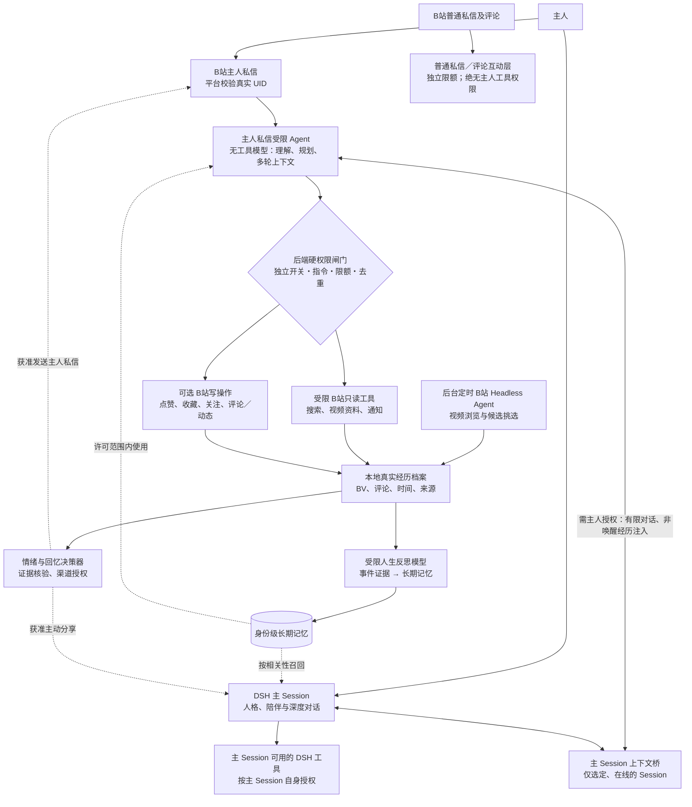

# 大肥鱼 Plus · 多 Agent 与主 Session 架构（2.5.0-dev.4）

> 开发快照文档。主分支 `v2.4.99` 仍是正式版。图中的受限主人私信 Agent 与主 Session 可见上下文桥是 dev.4 能力，**默认全部关闭**。此处「Agent」是职责与权限边界，不等于每个模块都是能随意调用工具的 DSH 主 Agent。

## 重要边界

- **同一角色，不同权限**：主人私信 Agent 可以读选定主 Session 的有限近期对话，却不能继承主 Session 的 Shell、文件系统、浏览器和其他插件权限。头脑中的「下一步」由无工具模型产生，工具实际执行在经过代码权限校验的 Host 中完成。
- **消息先归属，再解析**：B站收件箱核验的主人 UID 才能进入受限 Agent；普通用户（包括昵称像「主人」的用户）不会拥有主人权限。Agent 先接管主人命令，才轮到视频推荐与普通聊天，避免误加入待选池。
- **唯一授权主人由名册控制（dev.5）**：在「人设与好友 → 好友关系与互动」勾选一位「设为唯一授权主人」，保存时和 `dmOwnerUid` 一起校验与持久化。取消并保存立即清除主人 UID，切换则撤销旧 UID；主人私信/评论 Agent 在消息入口和实际写入前均重查 UID。昵称、其他角色画像、普通私信/评论、Agent 的 `bili_config` 工具不允许更改此授权。各写操作仍按独立开关校验；备份恢复后需要人工复核主人 UID。
- **短期上下文 vs 人生记忆**：私信 Agent 的短期焦点只保存有限 BV、搜索结果、草稿 ID 与简短对话；跨 Session 使用的长期记忆仍由既有证据和反思机制管理，不复制主 Session 完整历史到硬盘。
- **主 Session 同步可选**：读取对话与回写经历是两个独立、默认关闭的权限。读取仅从用户指定的在线 Agent 的 `session.deriveMessages()` 获取有限 user/assistant 纯文本，过滤可疑敏感信息，不读工具、系统、开发者消息或磁盘会话记录。无法读取时降级为没有最新主会话上下文。
- **非唤醒回写**：成功的任务结果可通过在线 Agent 的 `inject()` 提供给主 Session 下一个被唤醒的步骤；不会自动触发主 Session 对外回复。不同 DSH 版本如果 API 不可用，就记录不同步，不冒充已同步。
- **授权不得由模型推测**：每种写操作要求独立配置 + 最新主人消息中的明确动词 + 有效目标；生成评论草稿不能直接发布；同一消息执行前写入去重账本，结果不明不自动重试。最多 4 次模型规划步骤、每个相同只读动作最多执行一次。
- **不存储秘密**：只存本地短期任务信息、简要历史与执行状态；不会把主 Session 的全部对话保存到主人私信账本。**隐私过滤属于最小化保护，不代表能够百分之百发现所有秘密**，因此读取主 Session 需主人显式同意。

## 管理中心配置与保存（dev.4 管理界面修订）

- 在「私信与好友 → 主人私信 · 受限 Agent 与远程操作」使用独立的保存按钮，保存后通过 `/api/bili-duty/config` 回读所有相关字段；不再要求先通过「人生记忆 → 自主待办」的调度参数校验。
- 取消**界面上冗余的写操作总开关**：勾选任意写操作独立权限时，保存入口同步更新后端原有的总闸门；所有写入实际执行仍必须同时经过闸门、操作类型权限、主人真实 UID 与本条消息显式授权。没有自动开放任何旧配置中关闭的权限。
- 独立模型配置入口仍在「AI 模型配置」，其保存与 B站操作授权互相独立；主 Session 上下文的读取和写回仍默认关闭。

## 路径与模型

| 场景 | 主体与模型 | 对外工具 |
|---|---|---|
| 主 Session | DSH 选定的主 Agent | 主会话自身按权限配置的工具 |
| 定时刷 B站 | 独立 Headless 任务 | 只通过限定的 B站 MCP 工具清单 |
| 主人私信 | `lib/owner-dm-agent.mjs` 的无工具规划模型；`ownerDmAgentModel*` 单独设置 | 仅通过 Host 的执行适配器，受 `ownerDm*` 开关约束 |
| 普通私信、评论 | 后台互动模型 | 自动回复/公开行为原有白名单与额度 |
| 人生反思、回忆 | 受限反思模型和回忆决策模块 | 不拥有任意工具，分享由 Host 固定渠道执行 |
| 视觉理解、表情包规则 | 各自的可选模型 | 仅场景所需的受限信息 |

## 陌生人回复及昵称说明

陌生人默认 `dmStrangerMaxReplies=1`：第一条欢迎语已计数，后续「是的[妙啊]」被静默跳过，不是模型故障。需要在「私信与好友」将上限调到 2–3，或按既有申请机制允许继续聊天，才能获得后续回复。陌生人与主人、白名单好友的权限完全不同。昵称只能来自 B站返回的真实资料；无法获取时显示 UID，不根据聊天猜测昵称。新版在首次个人资料接口失效时尝试另一官方资料接口，空结果更快重试。

## 真实环境验收清单

1. 先在管理中心选定主 Session，再分别开通私信受限 Agent、只读权限和（如需要）主 Session 上下文读取／回写。默认写权限保持关闭。
2. 主 Session 提到天文主题后，主人私信「找一条天文视频发给我」，确认返回真实 BV 链接；「现在看看那条」应继续使用当前焦点，若目标不唯一必须追问。
3. 点赞权限关闭时即使 Agent 模型提出点赞也必须拒绝；开启后，主人本条消息明确说「给那条点个赞」，才允许执行一次。
4. 公开评论生成与发布分离，发布额度为零时必须被拒绝。网络结果不确定时不得自动二次提交。
5. 关闭上下文读取，私信 Agent 不应知道刚发生于主 Session 的新消息；开启后仅限所选在线 Session 的非敏感可见文本。
6. 同步开关开启后检查非唤醒经历注入；关闭时绝不可注入。
7. 用陌生人 UID 验证不能执行任何主人操作；将陌生人回复次数设置为 1 和 2，确认第二条回复行为符合额度规则。

以上为源码设计与模拟测试，不代表已在用户的真实 DSH Desktop / B站账号完成联网端到端验收。

## 好友互动不是多个独立白名单

目前 `dev.4` 的好友系统改为单一 UID 名册：主 Session、B站浏览 Agent 的公开 @ 决策、后台私信互动和主动社交草稿共用经过归一化的 UID 身份与授权，但使用各自的工具权限闸门。好友收到私信或通过 @ 留言提出的明确推荐偏好会记录到仅与该 UID 关联的本地观察档案，推荐发送前再次校验。公开 @ 的只读监听与公开评论回复是不同权限。详细流程与迁移边界见 [好友互动架构](./FRIEND_CONTACTS.md)。

## dev.5 主人公开评论 Agent 和自然表达层（开发版实现）

与本页描述的 **dev.4 私信 Agent** 不同，dev.5 的主人**公开评论** Agent 必须单独核验平台真实 UID 与评论所属 BV；只能接触本条评论、对应视频公开资料、受限操作状态及可公开的角色语气。即使发出请求的是主人，也**不能**因此访问主人私信、主 Session 近期对话、私密待办或其他好友画像。动作执行与可选的自然公开回复分离，评论发布有独立权限、额度、冷却、去重与未知回执保护。

完整设计见 [dev.5 社会认知与有机互动架构](./DEV5_SOCIAL_COGNITION.md)，宣传与验收边界见 [产品亮点文案](./DEV5_FEATURES.md) 和 [测试计划](./DEV5_ACCEPTANCE.md)。本页上方 dev.4 已实现的能力不因设计文档而自动升级。

## dev.5 社会认知模块与主人评论受限 Agent（源码开发快照）

`getNewDmMessages → dmAutoreply.onIncoming → socialCognition.observe`：新鲜真实私信分类为陌生人匿名临时探索主题或好友只读观看邀请。原有主人私信 Agent 仍优先分流独立处理，绝不会落入陌生人候选。

`commentInteract.onIncoming → ownerCommentAgent.accept`：只对真实主人 B站 @ 评论分流；仅接受真实 UID、平台视频 BV、评论 ID 与有效时间。后台独立动作权限控制点赞、草稿、明确正文发布；公众回复不读取 owner DM 主 Session 私密内容。普通评论模块在识别到主人动作指令时标记已交由该 Agent，不再额外 AI 回复。

`commentInteract.onIncoming → friend-learning + socialCognition.observe`：对已授权好友的 @ 反馈，更新个人偏好、全局视频推荐退订或独立只读观看候选。非好友 @ 不建立画像。情绪只影响择机只读行为，不扩大权限。

两项新 JSON 文件与旧记忆/主人私信账本分开，默认所有新开关关闭；此次未引入跨 Session 的社交隐私读取桥。
