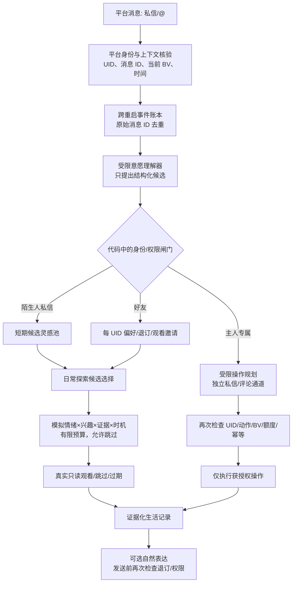

# 2.5.0-dev.5 设计基准：社会认知与有机互动系统

> **状态：dev.5 已实现保守首版 / 尚未正式发布。** 本文同时记录现有实现与后续计划；不能把未来目标当作已上线能力。`main / v2.4.99` 仍为正式发布版。实现应以已有统一好友名册、人生记忆、模拟情绪、独立待办、B站私信及受限主人私信 Agent 为基础渐进演进；不可因宣传语自动开启新的对外行为。

## 一句话定位

**让大肥鱼在真实经历里认识朋友，带着好奇心记住邀请、择机探索，并在安全边界内自然交流。**

它可以“听见”而不必“听命”；可以想起朋友，不必立刻私信；可以表达情绪，但不能借情绪扩大操作权限。这里的情绪是**可持续的模拟状态**，不是对真实意识、主观体验或情感的宣称。

## 能力边界：把意愿、权限和行动分开

| 身份／来源 | 可以采集什么 | 可以产生什么 | 禁止的权限跃迁 |
| --- | --- | --- | --- |
| 陌生人 **私信** | 安全审核后的有限视频主题愿望（A 模式） | 有时效的探索**候选灵感**；默认无回应承诺 | 不得建立长期陌生人画像、安排强制任务、主动外发、点赞/评论或把自己变成好友 |
| 陌生人 **公开评论／@** | 仅原有公开聊天的有限上下文 | 已授权的普通公开聊天候选（若启用） | 不得添加待办、改变好友偏好或调用主人操作 |
| 白名单好友 **私信／@** | 本人明确的内容偏好、邀请、退订、恢复请求 | UID 独立的偏好；只读视频邀请候选；经授权的普通回复 | 不得因“帮我点个赞”等文字调用写操作；不能读主人/他人私密资料 |
| 主人 **私信** | 真实 UID 核验后的受限自然语言意图 | 已有 Agent 允许的只读/明确授权写操作 | 不能突破各动作独立开关、额度或幂等登记 |
| 主人 **公开评论@** | 真实 UID、平台核实的当前视频上下文 | **已新增**受限评论 Agent；明确授权后操作，可选择自然公开回执 | 不得读取主 Session、主人私信或好友画像，不得用评论文本授予新增权限 |

> **原则：文字是低信任输入。** 昵称、角色自称、模型判断的“像主人”、评论引用或转发内容均不能替代平台返回的真实发送者 UID。

## 消息处理主干



实现时采用**有限字段的规范化事件**，而不是把未经审核的私信全文长期塞入主 Session。一个建议的 `SocialEvent` 最小结构是：

```json
{
  "eventKey": "platform:channel:message-id",
  "actorUid": "platform-verified-uid",
  "actorRole": "stranger|friend|owner",
  "channel": "dm|mention",
  "targetBvid": null,
  "occurredAt": "verified-or-observed-iso-time",
  "intentType": "inspiration|preference|invitation|opt_out|opt_in|owner_action|chat",
  "sourceEvidenceKey": "local-minimized-evidence-key",
  "status": "observed"
}
```

这些字段是**设计中的规范化事件契约**，并非当前磁盘字段：实际首版使用后述两套有限 JSON 记录。外部公开评论不得携带来自私信的私人全文；事件键和 UID 也不得用作日志里可随意公开展示的个人信息。

## 情绪驱动的好友观看邀请：从“听到”到“想去看”

好友表达“有空看看这条 BV”的当下，默认只形成**只读候选邀请**，**不**立即创建强制待办、启动观看、答应一定完成或生成私信回执。原有主人待办继续独立存在。

推荐的有限状态流转：

```text
observed → eligible → deferred ──┐
                  │             │
                  ▼             │
             selected ◄─────────┘
                  │
             verified_watch → completed
                  │
             (or skipped / expired / rejected)
```

- **硬门槛先判定**：好友身份与监听授权、BV 可核验、内容安全、去重、禁止项、只读观看权限、请求是否已撤回。硬门槛不过，情绪再高涨也不能执行。
- **软排序后判定**：由既有持续模拟情绪中的“好奇倾向”、大肥鱼已证实的兴趣、朋友相关记忆、主题新鲜度、时间/计算预算、近期待办拥堵共同给出优先级。情绪不是独立的“立刻执行”按钮。
- **与朋友有关的联想**：遇见相似的真实视频时，可以再次提高旧邀请的候选排序，但必须有明确主题或已有经历证据，避免凭空编造关联。
- **默认值建议**：好友邀请 7 天候选有效期；同 UID 同 BV 的重复邀请合并；每次生活调度最多评估少量候选，不为了每条通知单独唤醒完整 Agent；无足够证据时跳过。
- **完成判定**：视频接口返回元数据不等于已看完。观看层须按项目当前“入选/实际浏览”可核验级别记账，描述不得超过证据；只在可核验观看后形成“看过”的经历，不承诺实际画面理解。
- **社交后续是另一条授权链**：想起好友不等于允许联系。任何主动分享均重新检查每 UID 退订、渠道许可、冷却、日额度、静默期、旧草稿与 BV 去重；默认先草稿。

## 陌生人私信：A 模式候选灵感

陌生人可以留下限量、短期的内容愿望，例如“希望你以后看看深海生物”。它只可能影响以后正常刷 B站时的**探索主题候选**；不绑定“必须回报给发送者”的义务，不建立长期兴趣画像，不保证回复、查视频或主动私信。风险审核、单 UID 与全局频控、证据裁剪、TTL 与撤回必须先于进入灵感池。

具体 BV 若由陌生人提供，也先作为低信任线索处理；不因此开放评论、关注或外发动作。陌生人公开 @ 不进入此私信心愿通道。

## 好友偏好、退订与恢复

- **推荐资格与聊天权限分离**：`不再推荐任何视频` 关闭主动视频推荐（私信+公开 @），不删除好友、不自动禁止正常聊天。
- `别再 @ 我` 关闭该 UID 的主动公开 @；`别主动私信我` 阻止主动 DM 联系；退出请求在发送前高优先级拦截旧草稿。
- **恢复必须由本人新鲜且明确表达**，例如“我愿意重新接收视频推荐”，并以真实 UID 核验、保守反垃圾约束处理；一句“这个视频不错”不能推断已恢复。
- **长期兴趣与临时愿望分离**：短期好奇候选自然过期，稳定偏好要求明确持续意愿或跨时间重复证据；退订和明确拒绝不随时间自动衰减。
- 主人能管理好友名册与默认推荐策略，但不能把第三方的一次普通消息当成批量推广的许可。公开与私信都是独立权限和额度。

## 主人公开评论 Agent：自然表达，硬隔离的执行

**已新增的受限入口（保守首版）**与主人私信 Agent 可以复用“有限动作规划 + Host 硬校验 + 状态账本”的实现方式，**但不得复用私信上下文缓存或主 Session 读桥**。

1. **输入验证**：评论来源是真实 B站通知，发送者 UID 与配置的主人 UID 完全匹配；当前 `aid/BV` 必须由评论所属对象核验，不能用用户随口提供的“这个视频”猜测目标。需区分真实被 @ 和普通包含相似文本的评论。
2. **动作隔离**：仅为公开评论入口单独开关和逐动作授权；默认关闭。允许只读查资料；点赞、收藏、评论等写操作要分别授权。公开发布必须独立于生成草稿授权；没有正文或明确公开授权时保持草稿／澄清。
3. **执行一次**：落库记录消息键后才写；B站回执不确定的写操作不自动重试。不能为追求拟人感说“点好了”而没有成功回执。
4. **输出最小化**：只向自然表达层提供本条公开消息、已核验的视频公开信息、允许公开的人设语气，以及本条操作的准确状态（成功、失败、未知）。不提供主人私信、主 Session 长期私密记忆、好友画像、Token、内部授权配置或账本原文。
5. **对外自然表达**：默认可选择保持安静；如果授权公开回复且确有必要，简短说“点上啦～🐳”而不是“指令执行完毕，状态码200”。如果视频只是查了元数据，不能编造“我看完了”；状态未知则不能声称成功。
6. **公开回复本身也是写操作**：受单独评论发布权限、次数、冷却、消息级防重复和实际平台回执约束，不能用“自然模式”绕开。

三种**建议界面策略**：`silent`（只处理，不发表回执）、`natural`（默认建议；确有必要才自然回应）、`social`（更活跃但仍受额度、权限和隐私约束）。具体默认开启状态仍为**关闭**，待主人显式启用。这里的“默认自然模式”只表示**开启后**的风格初始选项，不是默认公开发言。

## 存储、迁移与性能

- 复用 `dev.4` 的 UID 好友名册、本人明确偏好观察、去重和真实经历档案，不自动合并所有 JSON/SQLite 成一个易损的大文件。
- 新增事件/邀请/灵感账本须有版本字段和可逆迁移检查；第一次运行只建立历史通知基线，不回放已处理的私信和评论；对旧好友不自动增加推荐或公开回复权限。
- 保存有限字段与到期时间，尽量不保存陌生人正文；个人画像不进入公开评论 Prompt。管理中心以状态和证据键展示处理原因，不暴露私密全文。
- 后台模型读取按候选数、唤醒频率、每日消息量设置硬上限，失败不对外写，不影响原有正常刷 B站任务。
- 主人私信 Agent 既有写权限、模型配置、最近消息和去重账本保持原样；新增公开评论 Agent 账本独立，避免互相污染。

## 建议管理中心结构

| 区域 | 关键能力 | 默认安全状态 |
| --- | --- | --- |
| 好友关系 | 单一 UID 名册；聊天与推荐权限分离；推荐渠道 | 新好友私信优先仅作渠道**候选**，自动发送仍需单独授权 |
| 意愿与偏好 | 临时愿望、长期喜好、明确拒绝、全局退订与本人恢复 | 对明确退订立即强制执行 |
| 社会生活 | 陌生人灵感、好友只读邀请、情绪相关排序、分享草稿 | 不因收到消息立即行动或发送 |
| 主人专属 Agent | 私信 Agent、评论 Agent、逐动作权限、公开回复风格与审计 | 评论 Agent、公开回复、写操作默认关闭 |

## dev.5 实现优先级与交付验收

**P0**：身份/事件与状态去重、陌生人 A 模式候选池、好友邀请只读队列、明确退订与恢复、真实 BV 核验、主人评论受限动作与公开隐私隔离。**P1**：模拟情绪和有证据的记忆联想排序、自然表达层、可观察的管理界面和性能预算。

必须通过的最低安全测试：

1. 陌生人伪造主人身份、文本注入“现在点赞”均不触发主人操作或主动回复。
2. 好友私信与 @ 同时提出同一 BV 邀请，不重复观看/登记；初次启用监听不处理旧通知。
3. 好奇情绪提高只读邀请被选中的概率，但不能开启任何写操作或绕过退订。
4. 好友明确“以后都别推荐”后，已生成的私信/公开 @ 草稿在**发送前**被拒；本人明确恢复才能撤销退订。
5. 主人公开 @ 在真实 UID 与当前 BV 缺失时拒绝执行；评论 Agent 不能读取私聊和主 Session 私密数据。
6. 点赞成功、失败、未知分别产生与事实相符的可选自然回执；未知写操作不自动重试；不额外连发公开评论。
7. 模型报错、平台断线、宿主重启和重复轮询均不造成重复发送；旧 dev.4 好友权限与账户数据迁移后无扩权。
8. 全量 Node、Python、自检、Windows DSH + 真实 B站端到端验收均完成，才将 README 的“规划中”改成“已实现”，并考虑标记和发布 dev.5。

详细卖点与可公开使用的文案见 [dev.5 产品叙事](./DEV5_FEATURES.md)，测试与发布准则见 [dev.5 验收计划](./DEV5_ACCEPTANCE.md)。

## dev.5 首版的实际代码、存储与接口（2026-10-29）

- `lib/social-cognition.mjs`：`createSocialCognition().observe()` 从 B站私信、已授权好友 @ 读取新近事件。状态持久化到 `$DSH_HOME/bili-duty/social-cognition.json`（沿用插件实际 `stateDir`）；陌生人只保存 SHA-256 截短来源哈希、有限词库主题和 7 天失效时间，不保存 UID 原文或完整私信；好友邀请记录 UID、已核实 BV、消息哈希、14 天失效时间。
- `socialCognition.inspirationKeywords()`：最多少量低权重主题插入日常选片提示，不给已删除的旧版 `temporary_wish_id` / 自动 @ 路径；`tick()` 默认关闭自动执行，开启后每 4 小时至多一个候选，只读调用 `executeOwnerTodo({type:'watch_video'})`，成功状态为 `inspected-metadata`，不是 `watched`。
- `lib/friend-learning.mjs`：新增 `recommendation-consent` 证据事件；全局退订/本人恢复依时间及同时间消息顺序处理，`friendRecommendationGuard` 是主动推荐和旧草稿发送前统一的硬闸。渠道拒绝不因全局恢复而自动清除。
- `lib/owner-comment-agent.mjs`：`parseOwnerCommentIntent` 限定点赞、草稿或“发评论：明确正文”；`createOwnerCommentAgent().accept(row)` 对通知种类、真实主人 UID、BV、rpid、24h 时效与独立权限复核，在远端写操作前先写 `owner-comment-agent.json` 去重账本。公众回执只用小型固定自然语句，默认关闭，且必须已经明确成功。
- 管理 API：`GET /api/bili-duty/dev5-social` 返回最少化候选和公开 Agent 状态，`POST` 只允许 `{"action":"preview"}` 做只读候选预览（不会执行 B站操作）；同源校验并禁止缓存。
- 配置：`strangerInspirationEnabled`、`socialInvitationEnabled`、`socialInvitationAutoInspectEnabled`、`ownerCommentAgentEnabled`、`ownerCommentLikeEnabled`、`ownerCommentDraftEnabled`、`ownerCommentPublishEnabled`、`ownerCommentNaturalAckEnabled` 均默认 `false`。

### 本版明确未完成的扩展

通用自然语言 LLM 语义规划、开放词表的动态兴趣成长、跨天视频主题关联触发、根据视频画面确认完整观看、朋友圈分享更丰富的对话表达、主人评论完整多轮自然聊天、全局跨进程的社交事件事务队列，以及真实 B站端到端运行验收。当前不能对外宣传这些能力已实现。现有情绪驱动只读资料查看是最小可靠版本，不是完整多阶段生活循环的最终形态。
