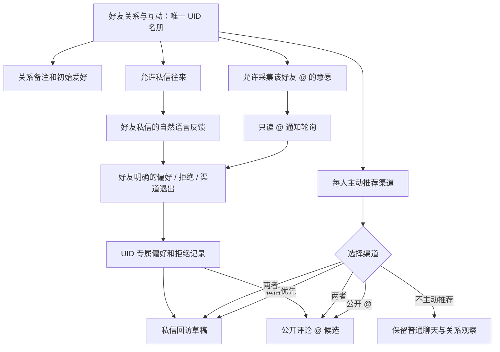

# 好友关系与互动：统一名册与双向意愿（`dev.4` 内部迭代）

> 这份文档说明开发版行为，不代表 `main` / npm `v2.4.99` 已发布这些设置。

## 一套好友名册，分开三种权利

- **唯一身份是 UID**。昵称、角色备注不能授予权限，也不能互相替代。
- **允许私信往来**与**主动推荐视频**是两个独立概念：好友可以与大肥鱼聊天，但明确选择“不主动推荐”，不会因此被定期发视频。
- **主动推荐渠道**：`dm`（默认新好友）、`mention`（公开 @）、`both`（两种独立可用）、`off`（不主动推荐）。`both` 并不强制在同一视频上两头都发；私信分享仍需独立的总权限、额度和冷却，公开 @ 仍需公开评论权限与 @ 策略。
- **读入 @ 意愿不等于公开回复**：`friendAtFeedbackEnabled` 是新的只读监听开关，默认关闭；`commentAtEnabled` 才允许 AI 生成公开回复。未启用公开回复时，好友的明确意见仍可以进入本地证据账本。
- **已有好友不会自动扩权**：旧配置按原 `dm`、`mention`、`atInvite` 映射为渠道；只有用户明确在新界面调整才改变权限。新添好友默认选择私信推荐、不开公开 @，并允许用户再按需关闭。

## 好友可通过私信与 @ 修改推荐偏好

例如白名单好友说：“以后别给我推这些，多推点美女视频”。系统只会对**该 UID** 记录明确偏好；否定类别需要核实 B 站公开视频标题，不能从“这些”任意猜测。对方明确说“别再 @ 我”时，记录 `mention` 渠道拒绝；对应的后续公开 @ 计划会被阻止，**不自动撤销仍被允许的私人聊天**。频道拒绝只能由主人清除好友兴趣观察或主动调整，不能被其他用户或提示词越权解除。

数据流保持本地独立：好友兴趣观察、已拒绝视频与渠道退出记录不进入公共评论提示词，不覆盖大肥鱼自己的兴趣和其他好友的偏好。评论文字本身不会成为模型工具调用权限。外发前仍按 UID、渠道、视频和当前配置再次校验。

## 上线检查与回归

1. 在「人设与好友 → 好友关系与互动」确认旧 UID、昵称、关系、私信往来权限和推荐渠道；保存之后重新读取。
2. 在「人生记忆 → 主动回访」单独开启草稿权限，自动发送仍建议保持关闭，先检查草稿是否符合好友偏好。
3. 只希望了解好友通过 @ 说的意见时，开启「只读收取白名单好友的 @ 意愿」，**不必开启后台公开评论回复**。首次轮询会建立历史基线，不重放旧消息。
4. 用新评论／私信验证“多推”“少推”和“别再 @ 我”这三类反馈，并检查此 UID 的后续草稿与公开 @ 候选是否被正确过滤。
5. 不能把自动化测试通过等同于实际 B 站私信送达或公开 @ 通知送达；真实账号需要单独验收。
