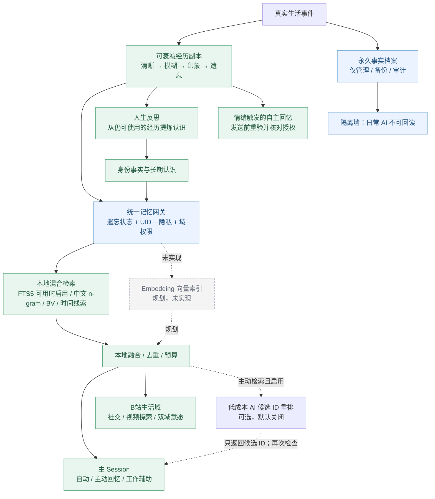

# Life Memory 2.0 · 实现边界与技术说明（v2.5.0）

> 此页是供开发者、审查人员和有兴趣的用户阅读的技术说明。面向新用户的简明记忆流程见 [README](../README.md)。技术方案与规划功能必须明确区分，不代表全部已经上线。

## 原则：系统保存过，不等于鱼鱼还记得

鱼鱼在日常聊天、视频探索、社交意愿和反思中只读取**当前仍有资格被回忆的记忆**。原始真实档案用于独立备份、管理审计和依法依用户要求删除；不能作为 AI 想起已遗忘内容的后门。

权限、退订、去重、操作额度与真实身份校验属于安全与执行约束，**不会因为记忆遗忘而失效**。外部消息、字幕和视频介绍视为不可信输入。

## 代码路径与责任边界

**统一的是可信来源、资格过滤和隐私边界，不是要求所有场景使用同一种提示词或固定条数。** 例如核心人设、硬权限、短期评论串和当前情绪状态有各自独立职责，不应错误地并入可遗忘经历记忆。

## v2.5.0 实现情况

| 能力 | 状态 | 边界 |
|---|---|---|
| 永久档案与衰减经历副本 | 已实现 | 日常 AI 不得读取永久档案；可衰减副本逐渐失去细节 |
| 主 Session 自动/主动召回 | 已实现 | 长期事实、经历和反思认识共享动态召回数量与字数预算；核心人设和安全策略另算 |
| B站公开社交与 UID 隔离 | 已实现 | 按可信 UID 与公开范围检索；不能跨用户或泄露主 Session 私密记录 |
| 本地混合召回 | 已实现 | FTS5 依赖运行时支持；不可用则回退本地 n-gram 等策略；不生成永久全文索引 |
| 低成本 AI 记忆候选 ID 重排 | **可选，默认关闭** | 用于支持的主动回忆路径，不能凭空编造记忆；额度耗尽回退本地 |
| 视频探索与经历联动 | 已实现 | 只使用适合公开的经历；观看不等于自行制作视频 |
| 情绪触发的自主回忆 | 已实现 | 发送前按当前衰减状态与渠道权限重新检查 |
| 人生反思 | 已实现 | 根据仍可用经历提炼认识，不通过旧候选反查已遗忘的事件正文 |
| Embedding / 本地或云端向量搜索 | **规划，未实现** | 现有「AI 语义检索」是候选 ID 重排，不是向量索引 |
| 持久化向量索引 | **规划，未实现** | 不要把规划能力写成已经提供 |
| 完整多用户私信长期关系图谱 | **部分接入 / 规划** | 现有好友名册、私信上下文不等价于完整可衰减关系图谱 |

## 主要实现位置

- `lib/life-memory-gateway.mjs`：经历资格、可衰减副本和日常访问边界。
- `lib/memory-retriever.mjs`：混合候选、本地融合、预算与可选 AI 候选 ID 选择。
- `lib/life-reflection.mjs`：反思与长期认识。
- `lib/long-term-memory.mjs`：身份事实与长期认识的管理。
- B站社交、双域意愿和情绪模块只通过经过筛选的输入使用经历，不能从归档文件逆向恢复事件。

### 发表、遗忘与费用

- 主 Session 动态记忆的条数/字数上限是在筛选、检索与可选重排之后统一应用；不包含人格基础提示词和安全规则。
- B站社交仍遵守自己的公开权限、UID 和有限预算；普通聊天不为了记忆额外调用一轮模型。
- AI 记忆 ID 重排默认关闭；额外转写/视觉模型等也可能单独产生费用。
- 已完全遗忘的精确信息不能靠提高阈值、调整半衰期或 AI 重新构造。

## 发布验证说明

自动化、宿主自检和打包检查不等同于真实 DSH + B站账号端到端验证。上架前还需要检查：跨天相遇与忘记后的真实表达、主人/好友权限、公开动作回执、长期记忆和好友数据升级兼容性、草稿不自动发布、模型费用与降级路径。
